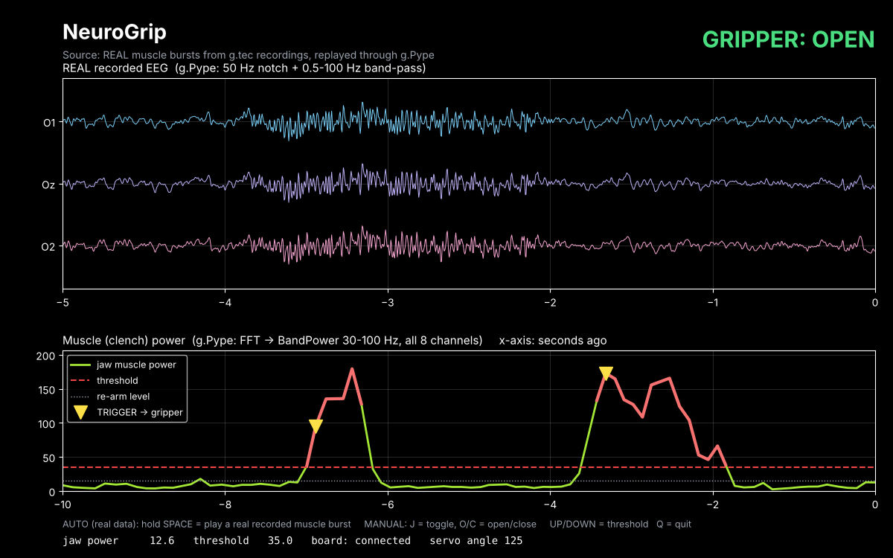
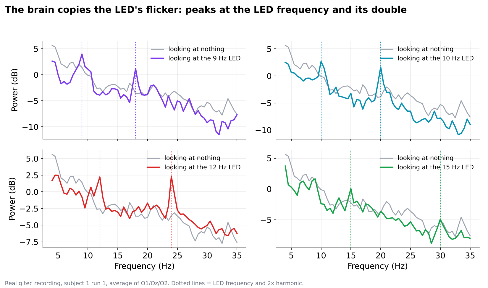
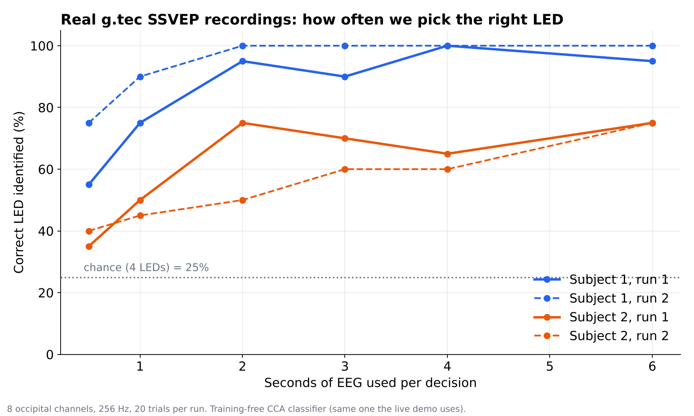

# Real g.tec data: how NeuroGrip was tested without a headset

At Hack the Nest 2026 the g.tec headsets weren't available. The organisers asked teams to use g.tec's
recorded datasets instead. So every signal in the NeuroGrip demo is **real EEG recorded by g.tec**,
replayed through **g.Pype**, g.tec's Python BCI framework, exactly as if a headset were streaming it live.

This page explains what the data is, what we did with it and what it does and doesn't show.

<p align="center">
  
</p>

## The data

The dataset is g.tec's **SSVEP LED dataset**. It came from the hackathon's g.tec track pack.

| | |
|---|---|
| People | 2 (subject 1, subject 2), 2 runs each |
| Electrodes | 8 over the visual cortex: PO7, PO3, POz, PO4, PO8, O1, Oz, O2 |
| Sample rate | 256 Hz |
| Task | 4 LEDs flicker at 9, 10, 12 and 15 Hz. The person looks at one LED for 7.4 s, rests for 3.1 s, and repeats: 20 trials per run, 5 per LED |
| File layout | `y` is 11 x samples: channel 1 is time, 2-9 are EEG in µV, 10 is the trigger (which LED, 0 = rest), 11 is g.tec's own LDA output |

The files go in [`software/gpype/data/`](../software/gpype/data/README.md).

## What "replay through g.Pype" means

```
g.tec .mat recording ──► g.Pype source node ──► g.Pype filters / FFT / BandPower ──► UDP ──► NeuroGrip detector ──► USB serial ──► gripper
   (real EEG, µV)        (plays it at 256 Hz,                                                (threshold, hold,           "t" = toggle
                          like a live amplifier)                                               re-arm, cooldown)
```

- The source is a real g.Pype node (`gp.Generator` subclass in `gpype_pipeline.py`). It outputs the recorded samples in real time, so everything after it behaves exactly as it would with a live headset.
- **Your key presses don't make signals.** They choose which recorded moment plays next, like skipping to a part of a song.
- The only processing outside g.Pype is a 1 Hz high-pass on load, which removes the electrode's DC offset so that the joins between clips don't jump, and 50 ms cross-fades at those joins. No samples are generated or changed.

## Demo 1: muscle bursts (the jaw-clench detector)

```bash
python neurogrip_live.py --muscle --no-board
```

NeuroGrip's main trigger is a **jaw clench**. Jaw muscles fire at 30-100 Hz, and EEG electrodes pick that up loud and clear.

**Being honest:** none of the g.tec datasets contains *labelled* jaw clenches. They do contain real **muscle bursts**: short stretches where the person tensed muscles during the recording. On the occipital electrodes that is most likely the jaw or neck. These bursts show the same fast, broadband 30-100 Hz pattern a clench produces. `dataset_replay.find_muscle_bursts()` finds them automatically. It looks for 30-100 Hz power above 8x the recording's median for at least 0.5 s. It found **6 bursts** (1.0-2.0 s each) in subject 1's two runs.

- **Press SPACE:** one real burst plays. It goes through the **same g.Pype jaw-clench chain the headset uses**: 50 Hz notch, FFT (64 samples), then BandPower 30-100 Hz.
- **Let go:** real calm stretches from the same recordings play.

| Measured through the g.Pype pipeline | 30-100 Hz power |
|---|---|
| Calm stretches | median ≈ 6, max ≈ 18 |
| Muscle bursts | ≈ 60 to 470 |
| NeuroGrip threshold | 35 (re-arms below 15) |

Each press triggered the gripper exactly once in testing, and the calm stretches never crossed the threshold.

**What this shows:** NeuroGrip's detector reliably separates real recorded muscle activity from real resting EEG.
**What it doesn't show:** that these exact bursts were deliberate jaw clenches. The dataset doesn't label them.

## Demo 2: SSVEP (looking at a flashing light)

```bash
python neurogrip_live.py --dataset --no-board
```

When you look at a light flickering at 12 Hz, your visual cortex pulses at 12 Hz too. This is called a steady-state visually evoked potential (SSVEP). The recording shows it clearly, with peaks at each LED's frequency and at double that frequency:

<p align="center"></p>

- **Hold SPACE:** the recorded trials play where the person looked at the 12 Hz LED. **Let go:** the recorded breaks play.
- **Keys 1-4** choose which LED's trials SPACE plays (9, 10, 12 or 15 Hz). The gripper only answers the 12 Hz LED, so pressing **1** (9 Hz) shows it ignoring the others.
- The detector is **CCA** (canonical correlation analysis). It compares the last 3 s of all 8 channels with 12 Hz sine waves and their harmonics. It needs no training session.

How often CCA picks the right LED, by recording and by how many seconds of EEG it gets:

<p align="center"></p>

| Recording | 1 s | 2 s | 3 s | 4 s | 6 s |
|---|---|---|---|---|---|
| Subject 1, run 1 | 75% | 95% | 90% | 100% | 95% |
| Subject 1, run 2 | 90% | 100% | 100% | 100% | 100% |
| Subject 2, run 1 | 50% | 75% | 70% | 65% | 75% |
| Subject 2, run 2 | 45% | 50% | 60% | 60% | 75% |

Chance is 25%, because there are 4 LEDs. Each trial is scored from 0.5 s after the LED starts.

Subject 1 is near perfect. Subject 2 is clearly above chance but much weaker. This matches g.tec's own research: SSVEP and P300 BCIs don't work equally well for everyone. That's a big reason NeuroGrip accepts several inputs (jaw clench, blinks, SSVEP, EMG, buttons) and doesn't rely on just one.

## Reproduce it

```bash
cd software/gpype
pip install -r requirements.txt
python neurogrip_live.py --muscle --no-board      # real muscle bursts
python neurogrip_live.py --dataset --no-board     # real SSVEP
python neurogrip_live.py --dataset data/subject_2_fvep_led_training_1.mat --no-board
```

Drop `--no-board` to drive a real gripper over USB (UNO Q running `firmware/GripTest`, 9600 baud). **J** toggles it by hand at any time.

## Credits

Data recorded by **g.tec medical engineering GmbH** and provided to Hack the Nest 2026 participants for the g.tec track. Processing pipeline built with **g.Pype** (free for educational use when run from source). All rights to the recordings stay with g.tec.
