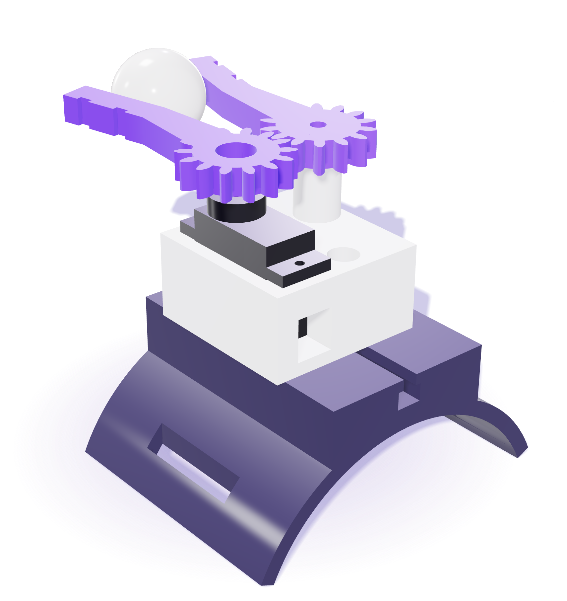
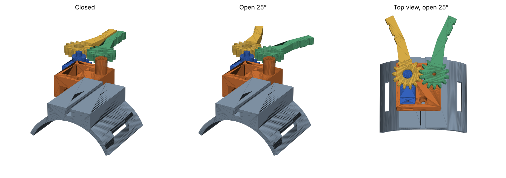

<p align="center">
  
</p>

<p align="center"><b>Think it. Grip it.</b><br>
An open-source, 3D-printed gripper you close with a jaw clench, read from an EEG headset.<br>
About $15 in parts. Prints without supports. Takes any signal you can measure.</p>

<p align="center">
  
</p>

---

> **Not a medical device.** NeuroGrip is a hackathon prototype for learning and research. It has not been tested with people with limb loss, it is not certified for any medical use, and an SG90 micro servo is only strong enough for light objects. Please don't rely on it for anything important.

## What it is

NeuroGrip is a two-finger gripper that straps onto a wrist. One SG90 servo drives two printed gear-fingers that mirror each other, so the jaws open from 2 mm to about 60 mm. An Arduino Nano moves the servo. A Python script on a laptop reads a g.tec Unicorn EEG headset over Lab Streaming Layer (LSL), spots a jaw clench (or a double blink), and tells the Nano to open or close.

It was built in 24 hours at **Hack the Nest 2026** (Eastern Michigan University).

The input is swappable. The same bridge works with OpenBCI, Muse, a MyoWare EMG sensor, a keyboard or button, or a simulator, and you can add your own source in about 30 lines of Python. See [Alternative inputs](docs/alternative-inputs.md).

## How it works

```
EEG headset ──Bluetooth──► Unicorn LSL app ──LSL──► neurogrip_bridge.py ──USB serial──► Arduino Nano ──► SG90 servo ──► gear fingers
(or OpenBCI, Muse, EMG,                              filters + detects     "toggle\n"        smooth moves,
 keyboard, simulator...)                             a clench / blink                        EEPROM calibration
```

1. **Intent.** You clench your jaw. The temporal muscles fire, and the headset picks up a burst of 30–100 Hz activity on every channel.
2. **Detect.** The bridge band-passes the signal, tracks its strength (RMS) and fires when it stays above your calibrated threshold for 150 ms.
3. **Command.** It sends `toggle` to the Nano over USB serial at 115200 baud.
4. **Actuate.** The Nano ramps the servo between your calibrated open and closed angles, then backs off 2° so the servo doesn't stall and buzz.
5. **Grip.** The driver finger sits on the servo horn and meshes with the idler finger, so both jaws move together.

Backups are built in: **SPACE** on the laptop and a **pushbutton** on the Nano both toggle the grip too.

<p align="center">
  
</p>

| | |
|---|---|
| Jaw range | 2 mm closed, ~53 mm at 30° of servo travel, ~60 mm at the 35° limit |
| Fingertip force | ≈ 0.35 kgf per tip (calculated for an SG90, not measured) |
| Gears | 14 teeth, module 1.5, 21.2 mm centre distance |
| Printing | 4 parts, PLA or PETG, no supports, ~40 g of filament |
| Mount | Curved wrist saddle with a T-slot rail and a 25 mm velcro strap |
| Signal | 8-channel EEG at 250 Hz (Unicorn), or any other source |
| Controller | Arduino Nano R4 (other Arduinos should work, see the firmware notes) |

## Bill of materials

Prices are typical online prices in USD, not quotes. Check your own receipts before you quote a number.

### Gripper

| Qty | Part | Notes | Approx. cost |
|---|---|---|---|
| 1 | SG90 micro servo | With its single-arm horn, horn screw and 2 tab screws | $2.50 |
| 1 | Arduino Nano | We used a **Nano R4**. A Nano clone is about $5 | $5–15 |
| ~40 g | PLA or PETG filament | PETG gives tougher gear teeth | $1.00 |
| 1 | M3×12 screw + washer | Idler finger pivot (self-taps into the base) | |
| 2 | M3×10 (or ×12) screws + 2 M3 nuts | Base to wrist rail | |
| ~30 cm | 25 mm velcro strap | Through the wrist mount slots | $4.00 for screws, nuts and strap |
| – | Rubber bands or grip tape | Fingertip grip | $1.00 |
| | | **Gripper total** | **≈ $13.50 with a clone Nano** |

### Electronics and power

| Qty | Part | Notes | Approx. cost |
|---|---|---|---|
| 1 | 470–1000 µF electrolytic capacitor (≥ 10 V) | Across the servo supply. Stops the Nano resetting | $0.50 |
| 1 | Momentary pushbutton | Backup trigger on D2 | $0.20 |
| 1 | 4× AA holder with NiMH cells, **or** a 5 V USB power bank | Servo power. Not 4× alkaline (6 V+ is above the SG90 rating) | $3–10 |
| – | Jumper wires, breadboard | | $3 |
| 1 | USB cable for the Nano | USB-C for the Nano R4 | – |

### Signal source (pick one)

| Option | Notes |
|---|---|
| g.tec Unicorn Hybrid Black | What we used. Research-grade 8-channel EEG, Windows software. Expensive |
| OpenBCI Cyton / Ganglion | Open-source EEG boards. Works over LSL or BrainFlow |
| Muse 2 / Muse S | Consumer EEG headband. Works over LSL (muselsl) or BrainFlow |
| MyoWare 2.0 + a second Arduino | Muscle (EMG) sensor, about $40. Probably the cheapest strong signal |
| Keyboard, foot pedal, big USB button | No sensor at all. Great for testing and as an accessibility input |
| Simulator | Built in. `--source sim` |

## Quick start

**Just want to print it?** The STLs are in [`hardware/stl/`](hardware/stl), and a zip of all four is attached to the [latest release](../../releases/latest). Settings are in the [printing guide](docs/printing.md).

You can try the software with no hardware at all.

```bash
git clone https://github.com/m2eyre/neurogrip.git
cd neurogrip/software
python -m venv .venv
# Windows:  .venv\Scripts\activate      Mac/Linux:  source .venv/bin/activate
pip install -r requirements.txt
python neurogrip_bridge.py --source sim --no-serial
```

Click the plot window and **hold J**. The blue line jumps over the red threshold and the terminal prints `TRIGGER`. Press **Q** to quit.

To build the real thing, follow the guides in order:

1. [Print the parts](docs/printing.md)
2. [Assemble the gripper](docs/assembly.md)
3. [Wire the electronics](docs/wiring.md)
4. [Install the software and flash the Nano](docs/software-setup.md)
5. [Calibrate the servo and your signal](docs/calibration.md)
6. Optional: [use a different input](docs/alternative-inputs.md) or [rebuild the website](website/README.md)

## Repository layout

```
neurogrip/
├── hardware/
│   ├── stl/                 Printable parts, already in print orientation
│   └── cad/
│       ├── solidworks/      SolidWorks VBA macro that builds the parts and a movable assembly
│       └── python/          The same geometry in Python: regenerate STLs, clash checks, renders
├── firmware/
│   ├── NeuroGrip/           Arduino sketch for the gripper (serial commands, button, EEPROM)
│   └── AnalogStreamer/      Optional sketch for an EMG / analog sensor on a second board
├── software/
│   ├── neurogrip_bridge.py  Signal in → detect → command out, with a live plot and calibration
│   ├── requirements.txt
│   └── sources/             Input plug-ins: template, keyboard, BrainFlow, serial analog (EMG)
├── website/                 Base44 reference site, design assets, screenshots and prompts
└── docs/                    Build, wiring, software, calibration and input guides
```

## Documentation

| Guide | What's in it |
|---|---|
| [docs/printing.md](docs/printing.md) | Slicer settings, orientation, supports, infill, materials, fit tests |
| [docs/assembly.md](docs/assembly.md) | Hardware list and step-by-step assembly |
| [docs/wiring.md](docs/wiring.md) | Wiring table, diagram and power advice |
| [docs/software-setup.md](docs/software-setup.md) | Arduino IDE, Python, LSL, Unicorn Suite, flashing the Nano |
| [docs/calibration.md](docs/calibration.md) | Servo angles, signal threshold, tuning, troubleshooting |
| [docs/alternative-inputs.md](docs/alternative-inputs.md) | LSL streams, OpenBCI, Muse, BrainFlow, MyoWare EMG, keyboard, writing your own source |
| [docs/cad.md](docs/cad.md) | SolidWorks macro, Python CAD, changing dimensions |
| [website/README.md](website/README.md) | Rebuilding the project website in Base44 (or anywhere else) |

## Why it matters

- An estimated **57.7 million** people live with a limb amputation caused by trauma ([McDonald et al., 2021](https://pubmed.ncbi.nlm.nih.gov/33274665/)).
- The WHO estimates that only **1 in 10** people who need assistive products, prostheses included, have access to them ([WHO, 2017](https://www.who.int/publications/i/item/9789241512480)).
- About **1 in 4** adult upper-limb prosthesis users stop using their device ([Biddiss & Chau, 2007](https://pubmed.ncbi.nlm.nih.gov/17979010/)).
- A powered (myoelectric) hand typically costs **$20,000 to $100,000+**.

NeuroGrip doesn't solve that. It is a small, open demonstration that the mechanical and control side can be cheap, printable and hackable, so more people can experiment with it.

## Status and known limitations

- The Python bridge was tested end to end with simulated data, the keyboard source and BrainFlow's synthetic board. Every headset and electrode placement is different, so always calibrate (press K) before you rely on it.
- The Arduino sketches have not been compiled in CI. If your board throws a compile error, please open an issue.
- The SolidWorks macro was written alongside the Python CAD and has not been run in every SolidWorks version. It reports any feature that needs a fallback in a message box at the end.
- Jaw-clench detection is an EMG artifact picked up by the EEG electrodes, not "mind reading". We say that plainly in the docs.
- The SG90 is weak. A metal-gear MG90S fits the same pocket (check the dimensions) for more torque.

## Contributing

Issues and pull requests are welcome: a stronger servo mount, more fingers, a laptop-free EMG mode on the Nano, better detection, or a new input source. See [CONTRIBUTING.md](CONTRIBUTING.md).

## License

See [LICENSE](LICENSE) and [docs/licensing.md](docs/licensing.md).

## Acknowledgements

Built at Hack the Nest 2026. Thanks to g.tec for the Unicorn headset and the LSL tools, and to the Lab Streaming Layer, BrainFlow, NumPy, SciPy, matplotlib, manifold3d and trimesh projects.
