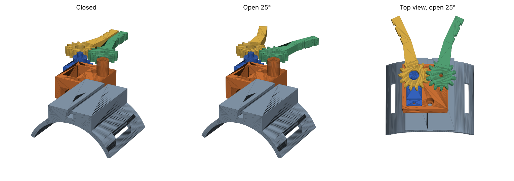
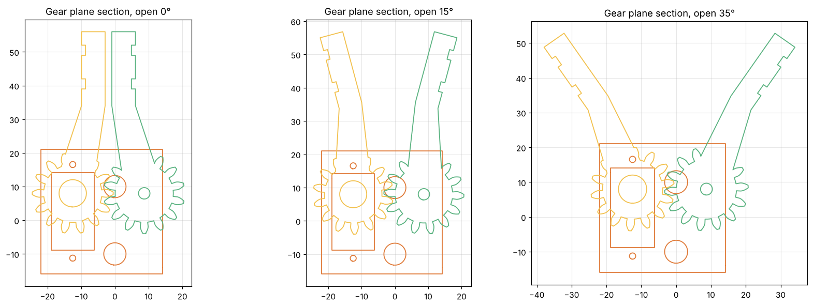

# Assembling the gripper

## What you need

- The 4 printed parts ([printing guide](printing.md))
- SG90 servo with its **single-arm horn**, the horn screw and the 2 tab screws
- 1× M3×12 screw + washer (idler pivot; it self-taps into the 2.6 mm pilot hole)
- 2× M3×10 (or M3×12) screws + 2× M3 nuts (base to wrist rail)
- About 30 cm of 25 mm velcro strap
- Rubber bands or grip tape for the fingertips
- Small Phillips screwdriver, M3 hex key or screwdriver to match your screws
- A way to set the servo to 90° before fitting the horn: the flashed Nano is easiest ([software setup](software-setup.md))

## How the mechanism works

Each finger is printed in one piece with a 14-tooth gear. The **driver finger** sits on the SG90 horn. The **idler finger** meshes with it and turns freely on an M3 screw, so the two fingers always mirror each other. Servo travel is limited to about 35°, which takes the jaws from 2 mm to about 60 mm.

## Steps

1. **Base onto the wrist mount.** Slide 2 M3 nuts into the T-channel on top of the wrist mount from one end. Set the base on the rail, put the M3×10 screws through the counterbored holes in the base into the nuts, slide the base to where you want it along the forearm and tighten. Do this first, because the rear screw ends up under the idler gear.
2. **Servo into the base.** Feed the cable and plug out through one of the wire windows. Drop the servo into its pocket with the **output shaft toward the fingers** (the shaft lands next to the pillar). Screw down both tabs with the servo's tab screws.
3. **Centre the servo.** Wire the servo to the Nano ([wiring](wiring.md)), flash the firmware, open the Serial Monitor and type `a 90`. The servo moves to 90°.
4. **Driver finger.** Press the horn into the driver finger's pocket. Push the finger onto the servo spline with the **jaw pointing straight forward**, which is the closed position. Screw the horn screw in through the hub hole.
5. **Idler finger.** Place it on the pillar so its jaw mirrors the driver jaw with about a 2 mm gap, with the teeth meshed. Fit the M3×12 with a washer, tighten until snug, then **back it off ¼ turn** so the finger spins freely.
6. **Grip surfaces.** Wrap rubber bands around each jaw so they sit in the two notches, or stick grip tape on the inner faces.
7. **Strap.** Thread the velcro up through one side slot, under the wrist, up through the other slot, and fold it back on itself.
8. **Find the opening direction.** Type `a 110`. If the jaws open, you're done. If they push into each other, your servo opens the other way, so use angles below 90 in [calibration](calibration.md).

Keep servo travel within about 35° of the closed angle (for example 90 closed, 120 open). The firmware refuses open/closed settings more than 40° apart.

## Fitting tips

- **Small or large wrist:** the saddle radius is 38 mm (adult wrist). Add 2–3 mm of foam inside, or change `WR_RI` and re-export ([cad.md](cad.md)).
- **20 mm velcro:** the slots are 26 mm long for 25 mm strap. Set `STRAP_LEN = 21` for 20 mm strap.
- **Loose horn:** a drop of CA glue in the pocket.

Next: [wiring](wiring.md).
