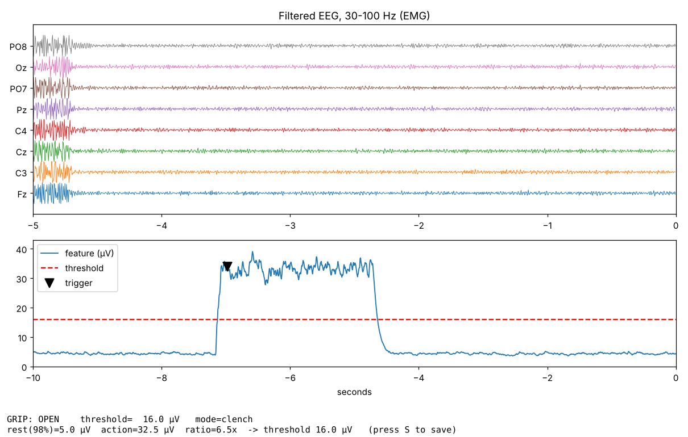

# Calibration

There are two separate calibrations:

1. **Servo:** which angles are "open" and "closed" for *your* print and horn. Done once, stored in the Nano's EEPROM.
2. **Signal:** how strong your clench (or blink, or EMG) looks compared with resting. Do it **every time you put the headset on**, because electrode contact changes.

## 1. Servo angles

Do this before tightening the horn screw for good. The design gives about 2 mm between the jaws when closed and ~53 mm at 30° of travel. Travel is mechanically limited to 35°, and the firmware refuses settings more than 40° apart.

1. Open the Arduino Serial Monitor (115200 baud, Newline) with the servo powered and **the fingers off**. Type `a 90`.
2. Fit the driver finger on the horn with the **jaws closed** (pointing straight forward), mesh the idler finger, and screw the horn on ([assembly](assembly.md)).
3. Type `a 100`, `a 110`, `a 120`. The jaws should open.
   - **If they push into each other**, your servo opens the other way. Use `a 80`, `a 70`, `a 60` and swap directions in the next steps.
4. **Closed:** use `a <deg>`, `+` and `-` to step 1° at a time until the jaws *just* touch (or are ~2 mm apart). Type `setclosed`.
5. **Open:** step the other way until the opening is what you want, about 25–30° from closed. Don't drive into the hard stop. Type `setopen`.
6. Test with `c`, `o` and `t`, with an object (foam ball, marker) in the jaws.
   - `relax 2` (default) backs off 2° after closing so the SG90 isn't stalled and buzzing. If it drops things, try `relax 1` or `relax 0`. If it buzzes and gets warm, try `relax 3`.
   - `speed 6` (default) is 6 ms per degree, about 0.2 s for 30°. Higher is slower and smoother, `speed 2` is snappy.
7. Type `save`. Settings survive unplugging.
8. Press the pushbutton. It should toggle each time.

**Check:** `s` prints something like `STATE OPEN angle=120 open=120 closed=92 relax=2 speed=6`. Write the numbers down.

## 2. Signal threshold

### Which signal, and why

The Unicorn's electrodes sit on top of the head, and real motor-imagery control needs a lot of training data. For a dependable result NeuroGrip uses two strong signals the headset picks up clearly:

- **Jaw clench (default):** clenching fires the temporal muscles, which shows up as a big burst of 30–100 Hz activity on every channel. The bridge band-passes that and tracks its RMS. Very reliable and easy to see on the plot. It is muscle activity (EMG) picked up by EEG electrodes, so call it a "biosignal", not "thought".
- **Double blink (`--mode blink`):** a blink is a large slow bump on the frontal electrode (Fz). One blink is ignored, so normal blinking doesn't trigger. Two blinks within 0.7 s toggle the grip.

### Put the headset on

1. Wet the electrodes or use gel as g.tec instructs. Make sure they touch skin, not hair.
2. Clip the two ear-clip references on the bony area behind the ears (mastoids).
3. Check **signal quality** in Unicorn Suite. All channels green before you continue.
4. Start the stream in **Unicorn LSL**.

### Run the guided calibration

1. Close the Arduino Serial Monitor, then run `python neurogrip_bridge.py`.
2. Sit still for 10 seconds and watch the **bottom plot**. The blue line is the clench strength and the red dashed line is the threshold. With a relaxed jaw it should be low and flat.
3. **Click the plot window**, then press **K** and follow the prompt at the bottom:
   - *Get ready* (3 s)
   - *RELAX* (10 s): loose jaw, eyes open, don't talk
   - *CLENCH your jaw and hold* (8 s): firm, steady, as if biting a stick
4. The terminal prints something like
   `rest(98%)=5  action=32.6  ratio=6.5x  -> threshold 16`
   and the red line moves.
   - A **ratio above 2×** is good. **Below 1.5×** you get a warning: re-wet the electrodes, check the ear clips and clench harder.
5. Clench briefly (about half a second). The gripper toggles and a ▼ appears. Clench again to toggle back.
6. Fine-tune with the arrow keys:
   - **False triggers** when you talk, chew or move your head → **↑** (+10 % per press). Or raise `--hold-ms` to 250–300.
   - **Misses** when you clench → **↓**.
7. Press **S**. This writes `software/neurogrip_calibration.json`, which loads automatically next time. (It is in `.gitignore`, because thresholds are personal.)

### How the threshold is picked

The calibration takes the 98th percentile of your resting feature (*r*) and the 70th percentile of your action feature (*a*; 99.5th for blinks), and sets the threshold at `r + 0.4 × (a − r)`, 40 % of the way from rest to action. A trigger needs the feature above the threshold for `hold_ms`, then it must fall below 70 % of the threshold before another trigger can count, and nothing can trigger for `refractory_ms` afterwards. These live in `Detector` and `Calibrator` in `software/neurogrip_bridge.py`.

### Blink mode notes

In blink mode the prompt asks you to double-blink every ~2 s. If blinks show as *downward* bumps on Fz in the top plot, set `"blink_polarity": -1` in `neurogrip_calibration.json`. To use a different frontal channel, change `"blink_channel"` (0 = first channel).

## Before a demo

1. Charge the headset and the servo batteries.
2. Plug in the Nano, power the servo, press the pushbutton: it toggles. *(Hardware works.)*
3. Headset on, check signal quality, start Unicorn LSL.
4. Run the bridge, press **SPACE**: it toggles. *(Laptop ↔ Nano works.)*
5. Press **K** to re-calibrate, then **S**.
6. Keep the plot on screen. People love seeing the spike cross the line.
7. If anything fails live, SPACE and the pushbutton still drive the gripper.

## Troubleshooting

| Problem | Fix |
|---|---|
| `No LSL stream found` | Start the stream in Unicorn LSL. Check the headset is connected. Allow Python through the Windows firewall if asked |
| `Could not find the Nano` / `Access denied` | Close the Arduino Serial Monitor. Unplug and replug. Pass `--port` |
| Servo jitters, Nano resets when the servo moves | Missing common ground or capacitor, weak batteries, or the servo is powered from the Nano |
| Servo buzzes while gripping and gets hot | Raise `relax`, or set `closed` a few degrees more open |
| Keys do nothing | Click inside the plot window first |
| Triggers constantly | Threshold too low (↑ or recalibrate), poor electrode contact, or raise `--hold-ms` |
| Never triggers | Threshold too high (↓). In clench mode, the top plot should show bursts on every channel when you clench |
| Big 50/60 Hz noise | Set `--mains` to your country's frequency. Move away from chargers. Run the laptop on battery |
