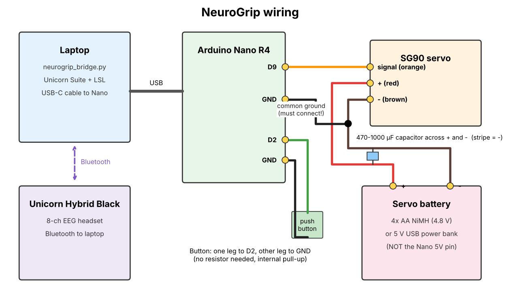
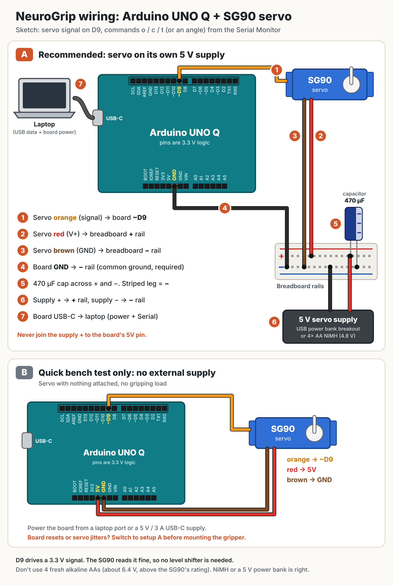

# Wiring

| From | To | Why |
|---|---|---|
| Servo orange (signal) | Nano **D9** | Control pulses |
| Servo red (+) | **+** of the servo battery | The servo gets its own power |
| Servo brown (−) | **−** of the servo battery **and** a Nano **GND** pin | Common ground. Without this the servo twitches or does nothing |
| 470–1000 µF capacitor | Across servo + and −, close to the servo | Absorbs current spikes so the Nano doesn't reset. The stripe on the can marks the − leg |
| Pushbutton | One leg to **D2**, the other to **GND** | Backup trigger. No resistor needed (the internal pull-up is used) |
| Nano USB | Laptop | Powers the Nano and carries the commands |

## Servo power

- Use **4× AA NiMH** cells (4.8 V) or a **5 V USB power bank** (cut a spare USB cable and use the red and black wires).
- **Don't** power the servo from the Nano's 5V pin. A stalled SG90 can pull more current than the USB port and the Nano's regulator like, and the board will brown out and reset.
- **Don't** use 4× alkaline AAs. Fresh ones give 6 V or more, which is above the SG90's rating.

## Pins at a glance

| Pin | Use | Change it in |
|---|---|---|
| D9 | Servo signal | `SERVO_PIN` in `firmware/NeuroGrip/NeuroGrip.ino` |
| D2 | Pushbutton to GND | `BUTTON_PIN` |
| Built-in LED | On while the gripper is closed | `LED_PIN` |

## Optional: EMG sensor on a second board

To use a MyoWare 2.0 muscle sensor instead of (or as well as) the EEG headset, wire it to a **second** Arduino and flash [`firmware/AnalogStreamer`](../firmware/AnalogStreamer/AnalogStreamer.ino):

| MyoWare 2.0 | Second Arduino |
|---|---|
| ENV | A0 |
| + | 5V (or 3.3V on a 3.3 V board) |
| − | GND |

Both boards plug into the laptop over USB. See [alternative inputs](alternative-inputs.md#emg-myoware-20).

## Using an Arduino UNO Q

The wiring is the same as above (servo signal on **D9**, separate servo supply, common ground, 470 µF capacitor). Three things differ on the UNO Q:

- **3.3 V logic.** The UNO Q's header pins run at 3.3 V. The SG90 reads a 3.3 V signal fine, so D9 needs no level shifter.
- **A0 and A1 are not 5 V tolerant.** If you wire a MyoWare (or any sensor) to a UNO Q, power it from **3.3V**, not 5V, so its output can't exceed 3.3 V. D3 is also only 3.6 V tolerant.
- **Power.** Power the board from a 5 V / 3 A USB-C port or supply. Its 5V pin shares that budget with the board's own Linux processor, so only use it for a servo on the bench with no load. With the gripper on, use the separate servo supply.

Next: [software setup](software-setup.md).
